# KolibriOS's own programs: shell, terminal, kfar, t_edit

Four programs of KolibriOS itself (its repository's `programs/`, GPL-2.0)
run on KolibriOS for ARM:

| Program | Original | Language there | Here |
| --- | --- | --- | --- |
| `shell` | `programs/system/shell` (Pavel "Albom" Mamontov and the KolibriOS team: Siemargl, Coldy, Leency, rgimad, ...) | C | built from its own sources, a small patch (`apps/shell`) |
| `terminal` | `programs/system/terminal` (hidnplayr) | FASM | translated to C (`apps/terminal`) |
| `kfar` | `programs/fs/kfar` (diamond, Evgeny Grechnikov, and the KolibriOS team) | FASM | translated to C (`apps/kfar`) |
| `t_edit` | `programs/other/t_edit`, `t_edit_synt` (IgorA, Igor Afanasiev, and the KolibriOS team) | FASM | translated to C (`apps/t_edit`) |

and the libraries they use: KolibriOS's console library (`console.obj`),
box_lib's widgets, libini, and in t_edit's case more (below).

## The sources

`tools/fetch-kolibrios.sh` fetches them, file by file, from KolibriOS's
own host at commit `855f02d2` (main, 2026-10-28), each checked by its
SHA-256 (`tools/kolibrios-files.txt`, 222 files, 2.5 MB), into
`third_party/kolibrios` (not kept in the repository, as lwIP isn't); the
Makefile runs it when they are missing. Gitea's API serves the files of a
commit (`/api/v1/repos/KolibriOS/kolibrios/raw/PATH?ref=COMMIT`). The
files come as they are there: CR LF, comments in CP866. Fetched besides
the four programs: `console_coff`, `box_lib`, `libini`, `msgbox`,
`proc_lib`, `opendial`, kfar's plugin `kfar_arc` (the libraries and what
the translations follow),
`KOSfuncs.inc`, `macros.inc`, `proc32.inc` and the like, ktcc's
`conio.h`, `shell_api.h`, `sys/ksys.h`, `icons32.png`, `icons18.png`,
the distributed `kfar.ini` and `icon2ext.ini`, `sysfuncs.txt`, and
`COPYING.TXT` (the GPL).

## C or assembler

KolibriOS's x86 assembler cannot run on ARM, so the FASM programs are
translated. All three are translated to C, not to FASMARM:

- terminal is calls into box_lib and the console on their structures;
  kfar and t_edit are large (kfar ~19 000 lines, t_edit with its box_lib
  parts ~10 000) and use the same libraries. In C the structures are
  shared through headers with the libraries, which are C too, and the
  programs build for both kernels without an assembler.
- The translations keep the originals' structure and names (labels as
  functions, the same globals and structures), with the original file
  and label at each function, so they can be followed side by side.
- FASMARM stays for programs written in ARM assembler from the start
  (`docs/asm.md`).

The shell is C already: it is compiled from its own sources. Its
`system/kolibri.c` does every system call with x86's `int 0x40`;
`apps/shell/kolibri.c` replaces it with the same functions through
`svc #0x40`. `apps/shell/arm.patch` changes three places: `ver cpu` and
`kfetch` used `cpuid` (now "ARM"), `lsmod` x86 inline assembler for
68.31 (now says there are no loadable drivers), and starting a program
waits 0.6 s for a console program's named shared memory (now as in
KolibriOS, see the shell's section). The parts of ktcc's `sys/ksys.h` and `shell_api.h` it
uses are in `apps/shell/include`. It is built with `-fpermissive`
(GCC 14 makes the original's pointer mismatches errors) and
`-fsigned-char` (x86's `char`). (`arm.patch` used to change a fourth
place, the wait for a console program's shared memory; with 68.22 that
works as in KolibriOS now: below.)

## The libraries: loaded as in KolibriOS

KolibriOS loads `console.obj`, `box_lib.obj`, `libini.obj` and the
others as shared libraries (function 68.19, COFF objects with an export
table). Here they are C libraries (`lib/NAME/*.c`, a program names them
in `LIBS_name`), built twice: as ARM libraries of KolibriOS's kind in
`/sys/lib` (`console.obj`, `box_lib.obj`, `libini.obj`: ELF shared
objects with the originals' export tables, loaded by 68.19 when the
program starts, `docs/threads.md`), and as `build/apps/lib/NAME.a` for
`make DLL=0`, which links them into each program as before. msgbox,
proc_lib and kmenu stay linked in. The functions keep the originals'
names and arguments (`con_init`, `con_printf`, `edit_box_draw(edit_box
*)`, `ini_get_str`, ...), and so do the export tables.

| Library | From | What |
| --- | --- | --- |
| `lib/libc` | (new) | the C library of the ported programs: string, ctype, stdlib (a malloc that frees, over 68.12), stdio's formatted output (printf to the debug board), `getcwd`/`chdir` (function 30), `main(argc, argv)` |
| `lib/console` | `console_coff/console.asm` (diamond) | the console window, all of `console.obj`'s functions |
| `lib/boxlib` | `box_lib` (Lrz, Mario79, Maxxxx32, diamond, hidnplayr, IgorA) | edit_box, check_box2, option_box, scrollbar, tree_list, the TED editor component (`box_lib.h`: box_lib.mac's structures, field for field) |
| `lib/libini` | `libs-dev/libini` (mike.dld) | settings files: `ini_get_str`, `ini_set_str`, `ini_get_int`, `ini_get_color`, `ini_get_shortcut`, `ini_enum_sections`, ... |
| `lib/kfar_arc` | `programs/fs/kfar/kfar_arc` (diamond) | kfar's plugin for archives, `/sys/lib/kfar_arc.obj`, loaded by kfar from its `[Plugins]` (below) |

The console works as `console.obj` does: `con_init` starts a thread
of its own (function 51) for the window, which draws (at most every
20 ms), reads the keys into the input buffer and handles the scroll
bar; the program's calls write into the buffer and wake the thread by
IPC (function 60, a byte: redraw, title, exit), and wait for keys as
console.obj's do. Its close button ends the thread that called
`con_init` (18.18) and then itself; after `con_exit(0)` the window
stays, "[Finished]" in its title, until it is closed. Its look is
console.obj's: 80 x 25 characters of its
8x16 font (`font8x16.bmp`), 300 lines kept, the scroll bar from
`conscrlv.bmp`, its 16 colours, its Esc sequences and key codes. In the
Hildon look the window is maximised and shows as many lines as fit.

## The files

KolibriOS's file systems, as function 70 knows them (`kernel/kfs.c`):

| Path | What | Writable | Kept |
| --- | --- | --- | --- |
| `/` | the devices: `rd`, `tmp0` (and `linux` on AArch64) | no | |
| `/rd/1` = `/sys` | the ramdisk: the files built into the kernel image (programs, settings, icons, syntax files), as folders and files | yes: copy on write over the kernel's bytes | until the next reset |
| `/tmp0/1` | an empty RAM disk (KolibriOS's tmpdisk) | yes | until the next reset |
| `/linux/...`, `/home/user/...`, `/tmp/...` (AArch64) | the Linux personality's tree (Yappari's and the messengers' data) | yes, in RAM; its ramdisk files read-only | until the next reset |

All of function 70's subfunctions 0-10 work on them (read, folder,
create/rewrite, write, set the size, information, attributes, start,
delete, make a folder, rename/move) with KolibriOS's error codes, and
function 30 gives every program a current folder (`/sys` at first,
inherited by the programs it starts). The RAM disks take their memory
in 4 KiB pages from blocks of 1 MiB and leave 16 MiB free for programs.

On the phones nothing is kept: the kernel has no driver for the Pro1X's
UFS or the N950's eMMC (nor their SD cards), so Leste's or Android's
`userdata`, the N950's MyDocs and any FAT partition are out of reach.
Everything written lives in RAM until the next reset; a file system on
storage (FAT on an SD card's partition, say) would be the next step for
keeping files. The same holds in QEMU.

## Kernel functions added for them

| Function | For |
| --- | --- |
| 70.0-70.10, 30 | all four (`kernel/kfs.c`) |
| 65 (images with a palette, 1-32 bits a pixel) | the console, kfar's screen |
| 66.1-66.3 (scan codes, every press and release; the control keys), 26.2 (KolibriOS's US layouts, from its kernel's `data32.inc`) | the console, kfar, t_edit |
| 37.1 relative to the client area, 37.3's events kept until the mouse changes again, its double click bit, 37.7 the wheel | box_lib, t_edit, the console's scroll bar |
| 54 (the clipboard) | t_edit, the shell |
| 48.3 (the system colours: KolibriOS's default skin's in the classic look, a dark set in Hildon's) | terminal, box_lib, t_edit |
| 68.16 "SERIAL", 68.17 (`kernel/serial.c`) | terminal |
| 51 (threads), 60 (IPC), 68.22, 68.23 (named shared memory), 68.19 (libraries): `docs/threads.md` | the console's thread, the shell's program console, the libraries in `/sys/lib` |

The loader now starts the heap behind a program's `.bss` (the header's
end of the image is `__bss_end`), and reads programs through kfs, so a
program written to `/tmp0/1` or over one in `/sys` starts.

## shell

All of the original's commands: `about`, `alias`, `cd`, `clear`, `cp`,
`mv`, `ren`, `date`, `echo` (with `>` and `>>` into files), `exit`,
`free`, `help`, `history`, `kfetch` (its coloured logo), `kill`, `pkill`,
`ls` (folders in colour, `ls -1`), `lsmod`, `mkdir` (with the folders
above), `more`, `ps`, `pwd`, `reboot`, `rm`, `rmdir`, `shutdown`,
`sleep`, `touch`, `uptime`, `ver` (`ver kernel`, `ver cpu`), `waitfor`;
running programs (from the current folder or `/sys`) and `#SHS`
scripts; `/sys/settings/.shell` (the original's) runs at the start. The
original has no `cat`: `more` shows files. `lsmod`, `reboot` and
`shutdown` say what KolibriOS for ARM lacks. A program started from it
may use its console, as in KolibriOS: the shell waits 0.6 s for the
program's named shared memory `PID-SHELL` (68.22; ktcc's
`shell_api.h`) and then prints, reads and clears for it until it says
it is done (`threadtest shellapi` is such a program, tests/apps runs
it); the others run in their own windows.

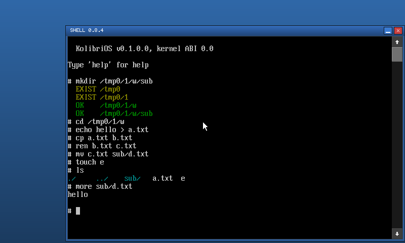
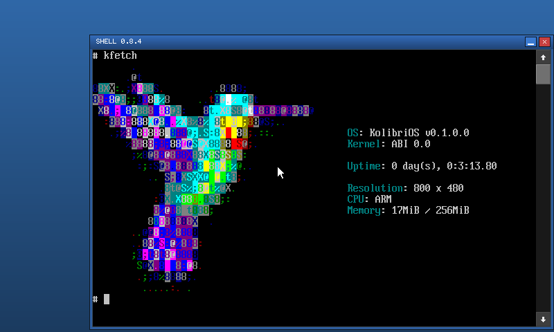

## terminal

What it is: a terminal on a serial port (hidnplayr's, 2014). Its window
asks for the port, speed, data bits, stop bits, parity and flow control
and local echo; Open (or Enter) opens the port through KolibriOS's
serial driver service and gives the window to the console, which sends
every key to the port and shows what comes from it.

Here the kernel offers that service itself (`kernel/serial.c`: function
68.16 "SERIAL", then 68.17's requests, as `drivers/serial/common.inc`
makes them): port 0 is the kernel's console UART (realview's and virt's
PL011, receiving polled; on the N950 and the Pro1X only sending, the
Pro1X having no UART at all), ports 1-3 are realview's other PL011s. The
settings are checked as the original checks them, not applied (QEMU's
UARTs don't need them, the console UART keeps the boot loader's).

In QEMU, realview's UART1 on a TCP socket: what is typed in the
terminal arrives there, what is sent from there shows in the console:

```sh
QEMU_EXTRA="-serial tcp:127.0.0.1:18799,server=on,wait=off" \
    python3 scripts/qemu-shot.py build/realview/kernel.elf /tmp/t wait:4 ...
```

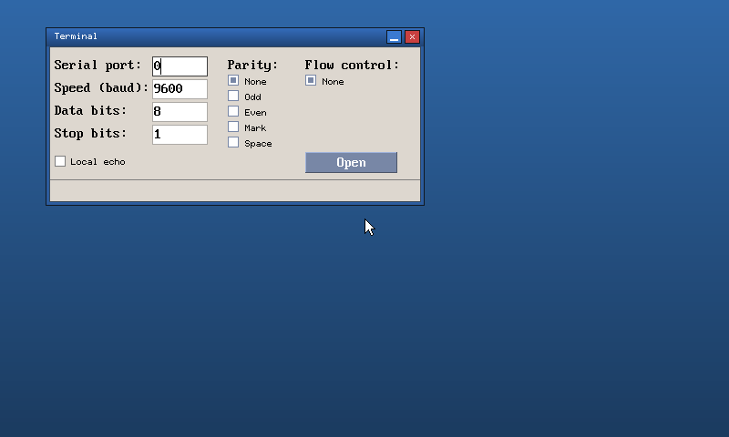
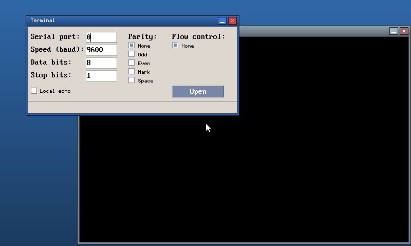

## kfar

Kolibri Far 0.65, all of it: about 19 300 lines of assembler became
about 10 300 of C (`apps/kfar`: `kfar.c` the start, events, keys, mouse,
screens and drawing, `data.c` its tables and dialog templates,
`panels.c` and `paneldraw.c` the panels, `dialogs.c`, `viewer.c` with
`search.c`, `editor.c`, `filetool.c` and `filesearch.c`, `sort.c`,
`tools.c`; `kfar.h` the shared structures; the labels, names and
structures the original's, each function naming its label). Its screen
is a grid of character cells in its own bitmap fonts, made from its
`font*.bmp` at build time (`apps/kfar/mkfont.py`, `make KFAR_FONT=` one
of font6x9, font7x12, font8x9, font8x16, font10x20), drawn with function
65; its colours and keys from `/sys/kfar.ini` (KolibriOS's distributed
one). The left panel starts in `/sys`, the right one in `/tmp0/1` (the
original's `/hd0/1` does not exist here); Alt+F1/F2 list the volumes.

Tried in QEMU (classic and Hildon looks, both kernels): moving, Tab,
folders in and out, starting a program with Enter, F3 (the viewer: hex,
wrapping, the encodings, searching), F4 (the editor: typing, joining and
splitting lines, F2 saving, searching), F5 and Shift+F5 (copying, into a
new folder too), F6 and Shift+F6 (moving and renaming: 70.10 on one
volume, copy and delete between volumes), F7, F8 with its question, the
sort modes (Ctrl+F3 ... Ctrl+F6), the column modes, Alt+letter quick
search, grey + and * selection, Alt+F7 (searching files and their
contents), F12 (the screens), F10. In the Hildon look kfar fills the
window under the panel; mouse clicks, double clicks and the key bar
work.

What differs: memory from the C library (68.13 does not give back,
68.20 is missing); the file search, a thread in the original, runs
in steps from the screen's idle handler; kfar 0.65 has F6 and Shift+F6
only on its key bar, here they move and rename. Fixed on the way, as
found: PgUp to the first file, the copy's destination under `/sys`, the
viewer with short paths, a few of the editor's block operations, the
file search's reads, the search automaton's fallback. Enter on a text
file starts the program `kfar.ini` associates with it, which is not on
this ramdisk (kfar says so).

### Plugins

kfar loads the plugins named in `kfar.ini`'s `[Plugins]` (the ramdisk's
has the original's entry, `ArchiveReader=/sys/lib/kfar_arc.obj`; a name
without `/` is relative to kfar's folder) with function 68.19, checks
their `version` (3, the only one kfar 0.65 takes), takes their exports
(kfar's defaults for the missing ones, kfar.asm's `*_default`) and calls
`plugin_load` with its `kfar_info`; `plugin_unload` when it ends. The
host side is the original's, translated into the files it was in
(`kfar.c`: `enum_plugins_callback`; `panels.c`: Enter, the folders,
`close_plugin_panel`; `paneldraw.c`: `ReadFolder`, `GetPanelTitle`;
`filetool.c`: the copy, `copy_AddFile`, `copy_AddDir`, `open2` and the
file layer on plugin files; `viewer.c`, `editor.c`):

- Enter on a file asks each plugin with the file's first 1024 bytes
  (`OpenFilePlugin`); the one that takes it gets a panel of its own: the
  state underneath kept in `parents`, the panel's title from the plugin
  (kfar_arc: the archive's name and the folder inside), its folders
  through `SetFolder`, `..` at its root closing it (the cursor back on
  the archive).
- F3 views and F4 edits a file in it (the plugin's `getattr`, `open`,
  `read`, `setpos`, `close`); F5 copies the selected files and folders
  (or the one under the cursor) out of it through the plugin's
  `GetFiles` (kfar_arc's flags ask for it) or, for plugins without it,
  the folders read through `ReadFolder` and `SetFolder`.
- As in the original, refused on plugin panels: copying into them,
  moving and deleting in them, Shift+F5, Alt+F7, saving from the editor,
  Enter on a file in them (no archive in an archive).

Tried in QEMU (realview): arc.zip and arc.7z opened, their folders in and
out, F3 and F4 on files in them (F2 says "Saving is not supported for
plugin panels"), F5 of files and of a folder, `..` closing them; an
encrypted 7z's password asked (a wrong one: "Error in archive data or
incorrect password", "Enter password" asks again), an LZMA2 7z refused
("Unknown method: 21") with kfar going on.

The ABI (`apps/kfar/kfar_api.h`, included by both sides): every
function of `api.txt` and every callback in `kfar_info` is a plain
AAPCS C function with `api.txt`'s stdcall signature (`__int64` is `long
long`, `bool` is C's); the three with register conventions become
`void *pgalloc(unsigned size)`, `void *pgrealloc(void *p, unsigned
size)`, `void pgfree(void *p)`. `kfar_info` (24 words), the dialogs'
templates (`DLGDATA`, `dlgitemtemplate`, for `DialogBox`), `listitem`
(`menu`) and `OpenPluginInfo` are laid out as the original's, checked by
`_Static_assert`. A plugin is an ARM library as `docs/threads.md` has
them: its first export `lib_init`, which kfar calls with its `malloc`,
`free` and `realloc` before `plugin_load` (the original does not
initialise plugins; an ARM library needs it for its memory), so the
plugin's memory and kfar's are one heap.

Also different: `open2` hands a plugin's `getattr` the file's attributes
(the original its fileinfo, so `filesize` said 0); a plugin folder whose
size is a multiple of 16 entries is read once (the original reads one
less again and again); Alt+F1/F2 on a plugin panel mark the drive of the
archive; the editor closes the plugin's file after reading it; a plugin
folder that cannot be entered while copying asks unless "skip all" was
chosen (the original's test is the other way round).

### kfar_arc

kfar_arc 0.17 (`lib/kfar_arc`): `kfar_arc.asm` and its includes, about
9 700 lines of assembler, in about 5 700 of C, file for file (`kfar_arc.c`
the interface for kfar and the folders, `zip.c`, `deflate.c`, `crc.c`,
`7z.c` with the decoders' streams, `lzma.c`, `7zbranch.c`, `ppmd.c`,
`aes.c`, `7zaes.c`, `sha256.c`), labels as functions as in kfar's port,
the original's error exits (`return.err`, `return.clear`) as
`__builtin_longjmp` to the entry functions. It is `/sys/lib/kfar_arc.obj`
(the Makefile's `DLLS`), exports the original's names (`kfar_arc.exp`:
`version` = 3, `plugin_load` ... `close`, `deflate_unpack`,
`deflate_unpack2`) and needs nothing outside itself.

| Archives | Methods |
| --- | --- |
| zip | stored, Deflate, Deflate64; the traditional PKWARE encryption (the password asked once, kept for the archive); zip64; split archives (`name.z01` ...) |
| 7z | Copy, LZMA, PPMd, BCJ, BCJ2, Deflate, Deflate64, 7zAES (AES-256, SHA-256 keys: encrypted headers too); solid folders, encoded headers, empty files and folders, attributes and times, CRCs |

What 7-Zip has and the original has not (LZMA2, BZip2, ARM, ARM64, PPC,
SPARC, Delta, ...) is refused with the original's "Unknown method:" and
the method's ID; another zip method with "Unknown method: N". Not here:
the zlib encoder the original links in (`../zlib/zlib.asm`: the exports
`deflateInit`, `deflateInit2`, `deflateReset`, `deflate`, `deflateEnd`,
`zError`, `calc_crc32`), which kfar does not use. kfar's 16 MiB of
memory bound what an archive may need: an LZMA dictionary (the smaller
of it and the folder's size), a PPMd model (7-Zip makes them small for
small files); a file that fits into a quarter of the free memory is
unpacked when it is opened, as in the original, here up to 2 MiB (the
original's `LIMIT_FOR_MEM_STREAM`, left undefined there: the free memory
it asks for is the system's, kfar's heap is 16 MiB), larger ones are
read as streams.

Fixed or changed, as found: the parent of a folder listed after its
files (the original leaves it at the root); a zip64 extra field read as
the specification says; LZMA's literal position when lp > pb; rep3 at
1; a match wrapped by the buffer's size; an empty file between a
folder's files takes no stream of it (as 7-Zip); a folder without its
attribute is a folder; setpos forward in a 7z file (the original adds
the high dword to the low one); BCJ gives the four bytes after E8/E9
back through a queue of its own; the PPMd heap's end aligned to 4 bytes;
7zAES keeps the rest of a block instead of writing it past the request;
`deflate_unpack`'s result is freed with `free`. The file handles come
from kfar's `pgalloc` one by one, not from a table of pages.

`apps/kfar/mkarc.py` makes `/sys/arc.zip` and `/sys/arc.7z` at build
time with Python's `zipfile` and `lzma` (stored and deflated files, a
folder only in the names; LZMA, LZMA after BCJ, Copy, an empty file and
folders): no tools, no downloads. `tests/kfar_arc` builds kfar_arc for
the PC (`gcc -m32`) with a kfar of its own and unpacks them and, with
7-Zip on the PC, zip Deflate64, Copy and ZipCrypto and 7z LZMA (encoded
and plain headers), PPMd, BCJ2, Deflate, Deflate64 and AES archives,
through the folders (with `setpos`, with and without memory streams) and
through `GetFiles`, compared with Python's and 7-Zip's unpacking:

```sh
make -C tests/kfar_arc
```

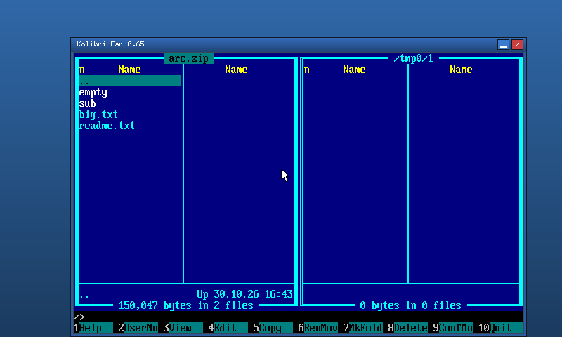
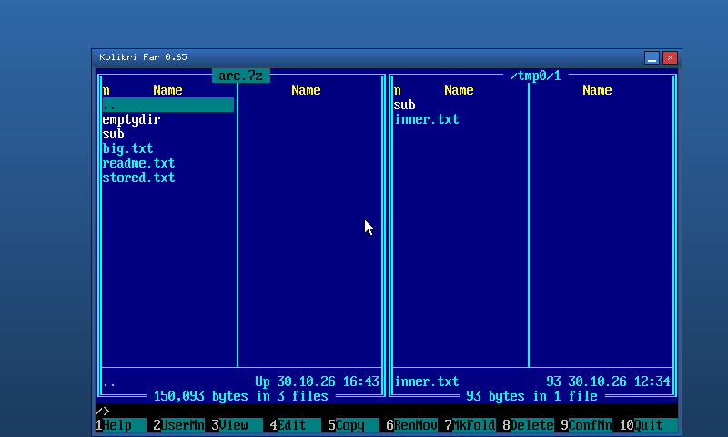
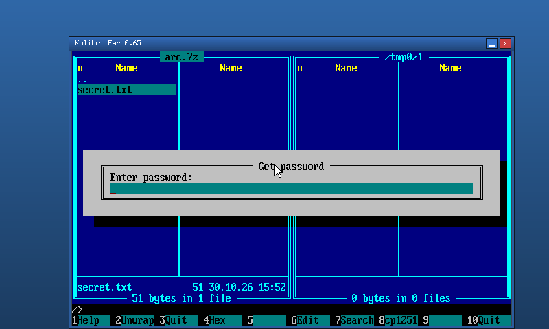

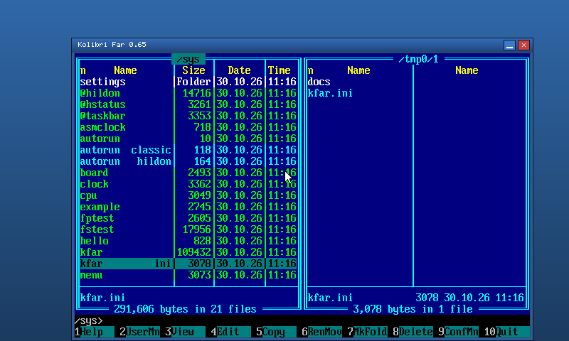
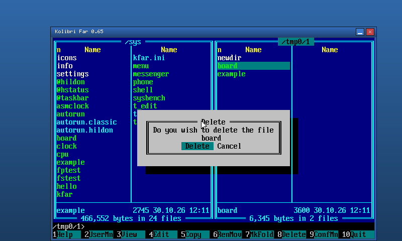
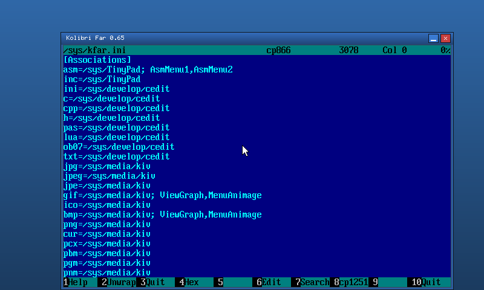
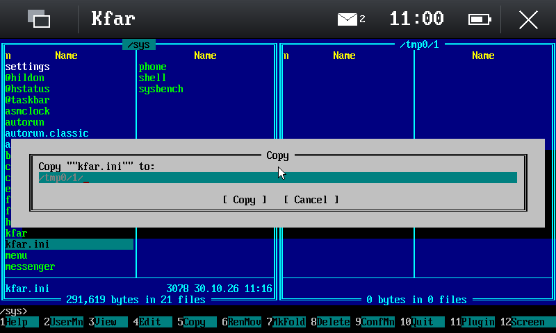
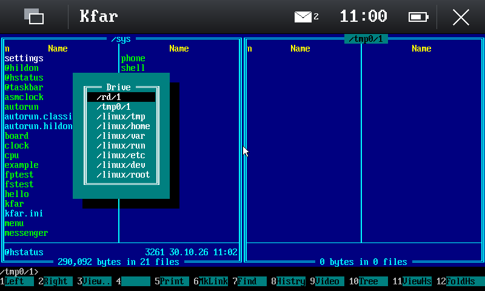
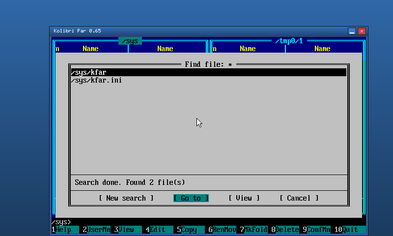

## t_edit

KolibriOS's text editor (IgorA's TextEdit) with its editor component:
`apps/t_edit` translates `t_edit.asm`, `t_data.inc`, `t_button.inc`,
`t_menu.inc`, `t_draw.inc`, `wnd_k_words.inc` and `strlen.inc` file by
file (about 2 800 lines of assembler, 1 500 of C); the editor itself is
box_lib's TED component (`t_edit.asm` there, 4 500 lines, now
`lib/boxlib/t_edit.c`, 1 900), with box_lib's edit box, check box,
option box, scroll bars and tree list beside it (`lib/boxlib`, their
structures field for field as box_lib.mac's, checked by
`_Static_assert`). Its other libraries: `lib/msgbox` (KolibriOS's
msgbox), `lib/proc_lib` (OpenDialog, which starts the program opendial),
`lib/kmenu` (the menu bar), libini.

Its look and keys are the original's: the menu bar, the toolbar with
`te_icon.png`'s icons (and their grey versions), line numbers, the
scroll bars, the syntax colours of `info/*.syn`, the panels (find,
replace, go to line, the syntax list as a tree list), the keyword
window, `t_edit.ini`'s settings, the file given as its parameter.
Tried in QEMU (both looks, both kernels): opening (an ini file,
assembler, both coloured), typing, selecting with Shift, Ctrl+C/X/V,
Ctrl+Z/Y, finding, replacing all, going to a line, choosing the syntax,
the keyword search, the menus, the open and save dialogs, saving, the
"Save changes?" question.

Its dialogs run as in KolibriOS, now that the kernel has threads, IPC
and named shared memory (`docs/threads.md`):

- The message boxes are msgbox's (`lib/msgbox`, `msgbox.asm`):
  `mb_create(data, thread)` starts a thread (51.1) on the stack the
  program gives (t_edit's `thread`) with a skinned window of its own in
  the middle of the screen, and returns at once; t_edit goes on. The
  button pressed lands in the data's first byte, and the box's thread
  calls the button's function (`mb_setfunctions`: t_edit's
  `On_SaveAndExit`, `On_NewFile`, `ted_but_open_file.no_msg`, ...) and
  ends; t_edit's window is redrawn when the box's window goes, and
  `On_Exit`'s `exit_code` ends t_edit there. Each box keeps its own
  variables and stack (the caller's, or one of the library's when a
  box's function shows another box, as t_edit's do when a file does not
  open); the original's are the library's globals, which a second box
  took over.
- The keyword window (`wnd_k_words.inc`) is a thread of t_edit's again
  (51.1 on the stack `thread_coords`, its TID in `wnd_k_words_run`,
  ended by 18.18 when t_edit ends) with its own window, events and
  keys. It takes its place from t_edit's window once at its start and
  has a buffer of its own for function 9: the original fills t_edit's
  `procinfo` with its own window's, which t_edit's thread reads at the
  same time.
- The open and save dialogs are the program opendial (`apps/opendial`,
  translated from `programs/fs/opendial/opendial.asm`), on the ramdisk
  where t_edit's `communication_area_default_path` looks for it:
  `/sys/File managers/opendial`, beside its `icon2ext.ini` (the icons by
  extension; the icons, libimg's `/sys/icons18.png` there, are built in).
  `lib/proc_lib` translates `opendial.mac`: `OpenDialog_init` makes the
  named shared memory `PPPPPPPP_open_dialog` (68.22, the caller's PID,
  written as the original writes it), `OpenDialog_start` puts the type,
  the window's place (in the middle of the caller's window), the folder,
  the file's name and the filter there, starts opendial with the area's
  name as its parameter (70.7) and polls the area's flag (68.1, 5, 11),
  redrawing t_edit's window meanwhile; opendial answers with the path
  and the name and the flag 1 (cancelled: 3), and its window's place
  and size for the next time. opendial's window is the original's: the
  path, the menus Select Disk (the disks: `/rd/1`, `/tmp0/1`), Sort and
  Filter, Refresh and ^ (the folder above), the list with its icons, the
  file's name when saving, Open/Save/Select and Cancel; its keys: the
  cursor keys, Enter, Backspace, Esc, Ctrl+R, Alt+F1/F2/F3 for the
  menus, Tab between the list and the name. box_lib's FileBrowser, menu
  bar and PathShow, which `lib/boxlib` has not, are drawn by
  `apps/opendial/fb.c` for what opendial asks of them (no marking with
  Insert, no search by the first letter); `sort.obj`'s orders are a sort
  of its own.
- In the Hildon look the kernel maximises every window but plain ones;
  a dialog is kept as it is (`kernel/wm.c`): a window first defined by a
  thread whose process shows another window already keeps its size and
  place, fitted into the work area, with the classic frame and title
  (its height grows by the title's, which 48.4 gives as 0 there), and
  stays above its program's windows when one of them is activated.
  opendial, a program of its own, is maximised like any other: a file
  chooser over the work area. The Hildon shell takes a dialog's window
  for one more window of its program (under the program's name).

What differs, and why:

- Fixed on the way in the dialogs: the filter is handed to opendial
  whole (opendial.mac copies its last three bytes short), the filter's
  extensions are compared whole (opendial.asm matches any suffix of
  one), the disks' table holds longer paths than the original's 10
  bytes (`/linux/home`), the name's box keeps to its 256 bytes, and
  OpenDialog_start stops waiting when opendial is gone without an
  answer (ended from outside). opendial sets its title with 71.1, which
  turns the window's caption on, as KolibriOS's `syscall_window_settings`
  does.
- kmenu has no source in KolibriOS's repository (only `kmenu.obj`):
  `lib/kmenu` is written anew with the API t_edit and `kolibri_kmenu.h`
  use; its drop-downs are drawn in the window (what they cover kept
  with function 36, put back with 7).
- t_edit's messages to @notify ("not found", the replacements made)
  are message boxes, as there is no @notify.
- The syntax files are assembled at build time from their sources with
  FASMARM, unpacked (`apps/t_edit/fasm2arm.py` turns FASM's `dw`/`dd`
  into FASMARM's `dh`/`dw` first); a file packed by kpack is refused.
  `t_edit_synt` (te_syntax) is the way back, from a .syn file to its
  FASM source, for someone who edits them with FASM; it is not ported,
  as there is no FASM on the devices.
- Ctrl+Y redoes; "Save" in the "Save changes?" question saves under the
  file's name when it has one; the window fits the work area. Bugs found
  on the way are fixed as the code meant (CR LF files' doubled blank
  lines, a scroll bar after appending, paste longer than an edit box,
  the clipboard's text read to its size, tree_list's node functions).
- Cyrillic shows in the kernel's cp437 glyphs (KolibriOS's system fonts
  are cp866; the console library has its own cp866 font).
- In the Hildon look, closing a changed file from the panel brings up
  the question in msgbox's window, which the shell puts in front; the
  panel's close button then closes that window (no answer, as its own
  close button) and asks again the time after: "Discard" ends t_edit.

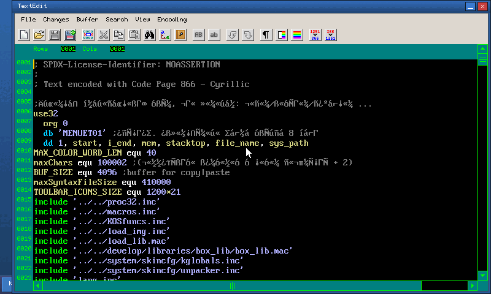
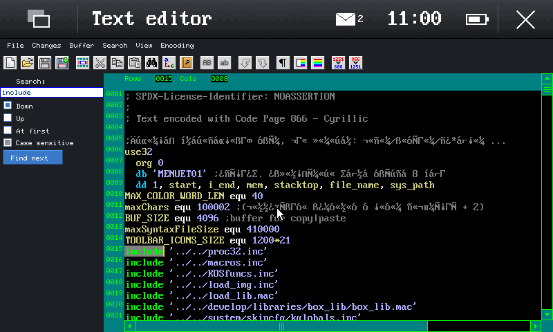
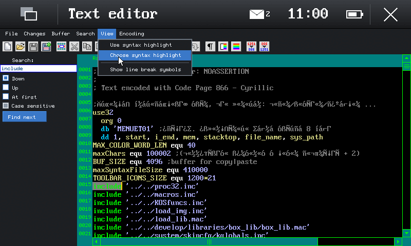
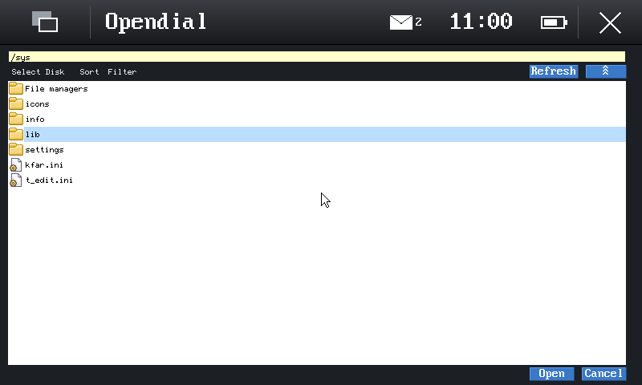
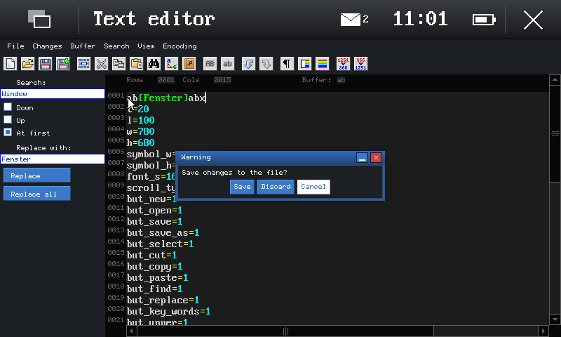
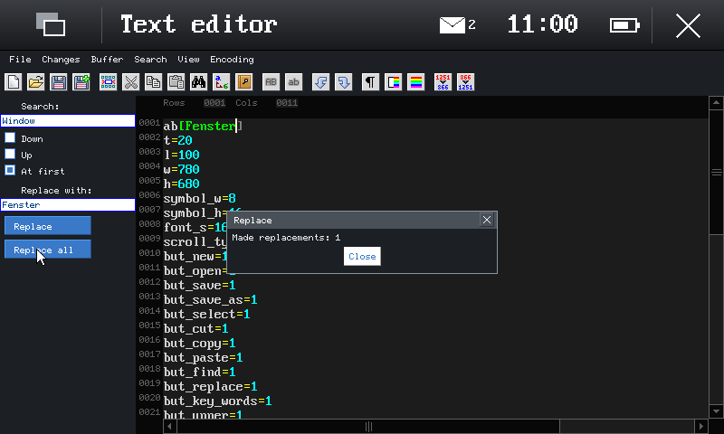

## Testing

`apps/fstest` checks the file systems and the other new functions from
a program (`fstest: done 0 failed` on the debug board); `tests/apps`
runs it on both kernels and drives the programs in QEMU through
`scripts/qemu-shot.py` (`tests/apps/keys.py` turns text into its key
steps): the shell's commands, the terminal against a socket, kfar's
and t_edit's operations (kfar copies, makes a folder and deletes, opens
`arc.zip` and `arc.7z` with kfar_arc, views and copies out of them; t_edit
types, undoes, replaces, copies and pastes and saves through opendial,
answers "Save changes?" and opens the file again from the box's thread;
fstest's `wait N expect PATH TEXT` in the autorun checks the files
afterwards), with screenshots:

```sh
make -C tests/apps            # or: python3 tests/apps/run.py kfar t_edit
make -C tests/apps IMG=docs/img
```
