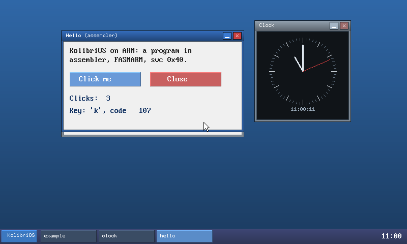
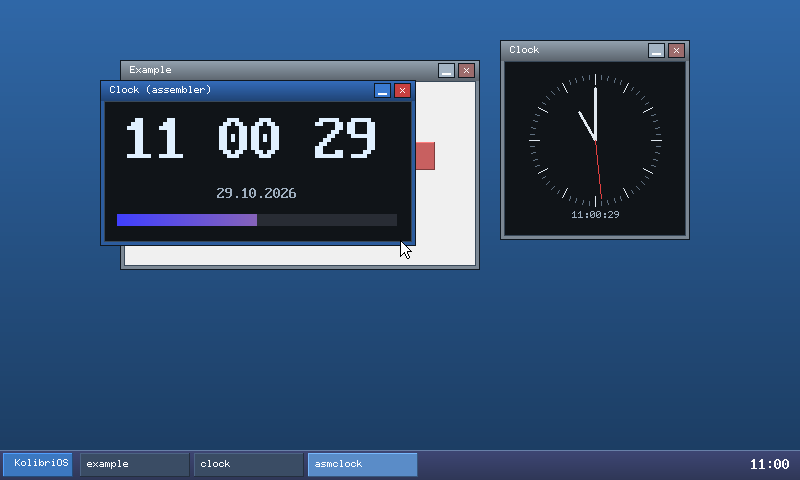
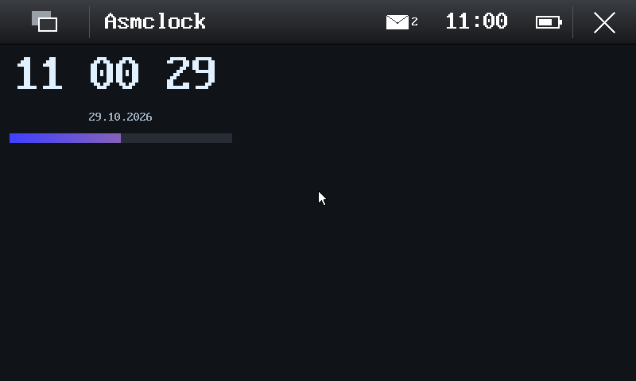

# Assembler: the kernel's hot paths, its fast ways in and out, programs

KolibriOS itself is assembler from top to bottom; this kernel is C. Three
things here bring some of that back where it pays:

1. the AArch64 kernel's hottest loops (drawing, the Pro1X's flush,
   memcpy/memset) in AArch64 assembler with NEON, the C versions kept,
   both checked against each other bit for bit;
2. the kernel's ways in and out (the system call from an AArch32 program,
   the interrupt, the task switch) tightened, the programs' FP/SIMD
   registers saved lazily;
3. programs in assembler, KolibriOS's way: FASMARM (the flat assembler
   for ARM), `lib/kos.inc` with the system calls, two examples.

Everything measured first, without trusting TCG's wall clock: QEMU's
instruction counts (a TCG plugin), and on the phone the generic timer
(`kolibri.bench`, `apps/sysbench`).

## Measuring

`tools/qemu-prof/prof.c` is a TCG plugin (QEMU's `qemu-plugin.h`): the
executed instructions of every translation block, written out when QEMU
ends; `report.py` adds them up by the kernel's symbols. `from=S` counts
only what runs S seconds after the start (the steady state after the
boot); `kbase=ADDR` makes marks: an AArch32 `orr r7, r7, r7` in a
program prints the kernel's and the rest's totals so far (`.marks`).

```sh
make -C tools/qemu-prof
QEMU_MACHINE=virt QEMU_EXTRA="-plugin build/qemu-prof/prof.so,out=/tmp/p.out,from=15" \
    python3 scripts/qemu-shot.py build/arm64/kernel.bin /tmp/p wait:35
python3 tools/qemu-prof/report.py /tmp/p.out build/arm64/kernel.elf 40200000 20
```

(`40200000`: where QEMU's virt loads the kernel, the second value of its
"boot arguments" line.) The Pro1X's code paths in QEMU take a device tree
of its kind (`tests/power/mkdtb.py`, `QEMU_DTB=`, `QEMU_MEM=8G`): the
1080x540 screen and its flush, turned and doubled, to a panel in RAM.
`tools/qemu-prof/autorun.prof` (`make PLATFORM=arm64
AUTORUN=tools/qemu-prof/autorun.prof`) starts board, cpu, example and the
clock behind the shell, the clock in front: it redraws every second.

Instruction counts do not see the memory system: on the phone the
flush writes 9.3 MB of uncached device memory per full screen, and the
bus decides there, not the instruction count. The device's numbers come
from the generic timer: `kolibri.bench` and `apps/sysbench` below.

### What the profile showed

The kernel's instructions in 20 s of the steady state (the clock in
front), QEMU's virt (800x480, ramfb, no flush) and the Pro1X's code
paths (1080x540, the flush):

| | virt, before | Pro1X, before |
| --- | --- | --- |
| all of the kernel | 83.0 M | 284.0 M |
| `p_display_flush` (turn, double, alpha) | - | 159.9 M (56 %) |
| `gfx_rect` (fills: the clock's window, the backgrounds) | 71.7 M (86 %) | 110.3 M (39 %) |
| `gfx_line` | 4.0 M | 5.3 M |
| `wake_waiters` (every trap: all 64 slots) | 2.7 M | 2.8 M |
| `cursor_show` (the pointer around every primitive) | 2.2 M | 2.7 M |

The boot (20 s from the start) the same way: 27.3 M (virt) and 81.5 M
(Pro1X), again `gfx_rect` (the background line by line) and the flush,
then `memset` (the owner map). Text (`gfx_text`) was 0.5-3.5 %, the
system call path about 1 %, but about 960 instructions per call: of
them some 730 in `wake_waiters`.

## 1. The hot loops in assembler (`kernel/arch/arm64/blit.S`, `string.S`)

`kernel/blit.c` has the inner loops of the drawing as plain functions
(no clipping, no globals; `blit.h`); `gfx.c` clips, takes the mouse
pointer away and marks the dirty lines, then calls them through a table
(`struct blit_ops blit`). `blit.S` has the same five in NEON:

| | what | NEON |
| --- | --- | --- |
| `fill` | a span of one colour, where the window owns the pixels | 16 owner bytes compared at once (`cmeq`); all owned: four 16-byte stores; none: nothing; else widened to word masks and `bit` into the old pixels |
| `glyph` | a glyph of the 8x16 or 6x10 font, unclipped | a row a step: the bits spread to lanes (`cmtst` against 0x80, 0x40, ...), and the owner mask, widened, `bit` |
| `from_bgr` | a line of a B,G,R image (function 7) | `ld3` takes the bytes apart, two rounds of `zip` make words |
| `to_bgr` | a line of the screen into B,G,R (function 36) | `ld4`, `st3` |
| `rot2x` | the Pro1X's flush: landscape to the portrait panel, turned clockwise, each pixel doubled both ways, alpha opaque | 4x4 blocks transposed (`trn1`/`trn2` on words, then doublewords), `zip` with itself doubles, eight panel lines written together with `st1 .2d` (8-byte elements: the panel is device memory, only 8-byte aligned) |

`string.S` has `memcpy`, `memmove` and `memset` on general registers
(`ldp`/`stp`, 64 bytes a loop), no NEON: they run everywhere, also under
a Linux thread whose FP/SIMD registers the CPU still holds. Every access
is aligned to its size, as lib.c's were: they also run with the MMU off
(all memory Device-nGnRnE) and on the Pro1X's uncached regions
(Device-GRE), where an unaligned access faults; so the fast path needs
`d` and `s` alike modulo 8 (or 4), else bytes. `size_t` is 32 bits in this
kernel: the count is extended from `w2` first.

Gone in C on the way: functions 7 and 36 went pixel by pixel through
`gfx_pixel` (the clipping, the pointer and the dirty lines for each
pixel); now by lines, in C and in NEON alike. The mouse pointer's
picture is drawn from bit masks, its background kept by `memcpy`.

The choice: the assembler's unless the kernel is built with
`make PLATFORM=arm64 SIMD=c` (C only, no `.S`) or started with
`kolibri.simd=c`; the console says `drawing: NEON` or `drawing: C`. The
ARMv7 kernels (QEMU's realview, the N950) keep C.

The kernel uses no FP/SIMD registers otherwise (`-mgeneral-regs-only`);
before its NEON, `blit_begin()` saves a Linux thread's or a program's
registers if the CPU still holds them (part 2).

### The numbers (QEMU, instructions)

`make -C tests/asm bench`: the routines on the Pro1X's sizes under
`qemu-aarch64` with the plugin, the C compiled as the kernel compiles it
(clang -O2, no FP/SIMD registers, aligned accesses):

| routine, workload | C | NEON | |
| --- | --- | --- | --- |
| `fill`: three screens of 1080x540 (everywhere, a window's 2/3, the other 1/3) | 6 582 600 | 1 224 180 | 5.4x |
| `glyph`: 2000 8x16 (half with background) and 2000 6x10 | 4 292 233 | 1 510 510 | 2.8x |
| `from_bgr`: nine 270x136 pictures (the task switcher's) | 4 036 752 | 476 136 | 8.5x |
| `to_bgr`: 270 lines of 270 pixels | 564 300 | 26 730 | 21x |
| `rot2x`: the whole screen to the panel | 7 908 876 | 1 463 433 | 5.4x |
| `memcpy`: 2.3 MB, aligned | 1 348 666 | 473 864 | 2.8x |
| `memset`: 583 KB (the owner map) | 100 269 | 72 931 | 1.4x |

The kernel, the same 20 s of the steady state as above (QEMU):

| | before | after |
| --- | --- | --- |
| virt | 83.0 M | 17.8 M (fill 11.3 M, line 2.5 M, the pointer 0.9 M and its memcpy 0.9 M) |
| Pro1X | 284.0 M | 52.6 M (rot2x 26.2 M, fill 17.7 M, line 3.4 M, the pointer 1.1 M) |
| boot, virt | 27.3 M | 11.4 M |
| boot, Pro1X | 81.5 M | 20.7 M |

### The device's numbers: `kolibri.bench`

`kolibri.bench` (or `kolibri.bench=N`: N runs each, the shortest
counts; 5) times every routine, C and then NEON, with the generic timer,
before the first program starts (interrupts still masked: nothing comes
between), on buffers of the screen's size in RAM of their own; the last
line is the real flush to the panel. Then the system starts as usual.
In QEMU (meaningless times, TCG):

```
bench: 800 x 480, 62500000 Hz counter, best of 5; C, then assembler (NEON)
bench: fill, everywhere:           C 518 us, asm 155 us, 3.3x, 9855 MB/s
...
bench: done
```

On the Pro1X (prepared, 2026-10-31; from a running Maemo Leste as root,
the kernel as `/host/kolibri/kernel.bin`, `docs/pro1x.md`):

```sh
tools/pro1x-kexec.sh /host/kolibri/kernel.bin \
    "kolibri.nomodem kolibri.psci=off kolibri.bench kolibri.run=/sys/sysbench kolibri.lifetime=60"
# after the reset, back in Linux:
tools/pro1x-read.py | grep -E "^(bench|sysbench|drawing):"
```

Expected: `drawing: NEON`; `bench: 1080 x 540, 19200000 Hz counter,
best of 5; ...`, twelve lines and `bench: done` (about a second in all,
well inside the watchdog's 32 s with the interrupts masked), then the
sysbench lines (below) and the system as usual until the lifetime's
reset. What to look for: the fills and the pictures several times
faster with NEON (the A53 stores 16 bytes where C stores 4); the turn to
RAM (`turn+double to RAM`) too; `the flush (display)` least, as the
panel's device memory decides; `memcpy 2 MiB, d+4` (alike only modulo
4) less than the aligned one. A line `asm` slower than `C` is the thing
to report.

## 2. The kernel's ways in and out

**The system call and the interrupt from a program.** Before, every
exception saved x0-x30, ELR and SPSR on the stack (34 stores), `trap64`
copied r0-r14 into a local `struct trapframe`, `trap_dispatch` copied
that into the task (`memcpy`, 72 bytes), and the way out copied a task's
frame into the stack frame (x15-x30 zeroed) and loaded all 31 again.
Now the A32 vectors (`start.S`) store r0-r14, pc and cpsr straight into
`current->tf` (8 `stp` of w registers, using x15-x18, which AArch32
code cannot see, as scratch) and `trap32()` hands back the next task;
if it is an AArch32 program, `a32_return` loads its frame and `eret`s.
Only a Linux thread or the idle loop goes through the full frame. The
idle loop's interrupt saves nothing at all (the loop is entered afresh).
The syscall table itself was already a jump table (clang's `switch`).

**The scheduler** ran over all 64 slots on every trap (`wake_waiters`,
the round robin, `sched_next_work`): now up to the highest slot used.

**The task switch** flushed the whole TLB (`tlbi vmalle1`, the kernel's
entries too). Now the programs' mappings are not global (nG) and each
tree has an ASID (from its root's address, 1-255; 0 the kernel's own
tree): the switch only loads TTBR0. An ASID's entries are thrown away
(`tlbi aside1`) when it serves another tree than before or its tree was
made anew (`mmu_asid_forget`: a new program, a Linux process, a freed
tree); the Linux personality's own table changes flush everything as
before. QEMU flushes its TLB at an ASID change anyway, so this shows
only on the phone.

**FP/SIMD lazily, now also for programs.** The Linux threads' registers
were already lazy (`lx_fp_owner`: saved only when another Linux thread
runs). The AArch32 programs' were not kept at all: they are built
soft-float, but a program in assembler may use VFP and NEON. Now
(`arch/arm64/fpu.c`) a program runs with CPACR_EL1.FPEN = 01 unless the
registers hold its own values: its first FP or NEON instruction traps
(EC 0x07), the registers' owner so far is saved, the program's own are
loaded (zeros the first time) and it runs on with FPEN = 11, also after
switches, until someone else needs them. At most one owner (a Linux
thread or a program) holds the registers; the kernel's NEON saves
whichever it is. `suspend.S` keeps the registers across a power-down
with FPEN 01 too (it checked for 11 only).

`apps/sysbench` (started by `kolibri.run=/sys/sysbench`) times, with the
generic timer from EL0 (CNTVCT through CP15), 100000 calls of function
26.9, 20000 yields alone, and 20000 yields to a second copy of itself and
back (two calls, two switches); `tools/qemu-prof/sysbench.sh` counts the
kernel's instructions between its marks:

| kernel instructions | before | after |
| --- | --- | --- |
| a system call (function 26.9) | 961 | 223 |
| a yield, alone | 1659 | 251 |
| a yield to a peer and back | 2718 | 606 |

On the phone (the command above): `sysbench: 19200000 Hz`, then
`sysbench: 100000 x function 26.9: N ns each`, the yields, `sysbench:
done`. For the times before, the same run with the kernel of commit
e4e77c1 (sysbench there, the old ways in and out):

```sh
git worktree add /tmp/kos-old e4e77c1 && cp -a third_party /tmp/kos-old/
make -C /tmp/kos-old PLATFORM=arm64     # /tmp/kos-old/build/arm64/kernel.bin
```

`apps/fptest` (`kolibri.run=/sys/fptest`) checks the lazy registers: two
copies fill d0-d31 and FPSCR with values of their own, yield to each
other or have the kernel draw (its NEON) in between, and check them:
`fptest: ok, 3000 rounds` twice. Without the lazy switching it fails in
the first round (the peer's values, or the kernel's fill colour, in d0).

## 3. Programs in assembler: FASMARM

[FASMARM](https://arm.flatassembler.net/) is the ARM version of flat
assembler (FASM, KolibriOS's own assembler), by "revolution" on Tomasz
Grysztar's FASM 1.73: ARMv1 to v8, AArch32 and AArch64, Thumb, VFP,
NEON, with FASM's macro language. Version 1.44 (2023-07-01) is the
latest.

- **Licence:** FASM's: "free for commercial and non-commercial use",
  redistribution in source and binary form with the copyright notice
  and the disclaimer kept, and the terms may not be changed (no
  relicensing, also not to the GPL); the text is at the top of
  `source/armv8.inc` in the package. It is a build tool here: nothing of
  it is in the repository or in the programs.
- **Getting it:** `tools/fetch-fasmarm.sh` (the Makefile runs it, like
  `fetch-lwip.sh`) fetches `FASMARM_full.ZIP` of 1.44, checks its SHA-256
  (`3b424490014303584c4f8bcc8a1a665cdb7f52f37186059a0ced07f4b357adb7`)
  and unpacks it into `third_party/fasmarm`. arm.flatassembler.net did
  not resolve on 2026-10-30; the script tries it first, then the
  Internet Archive's captures of 2025-06-06 and 2026-10-05, which are the
  same bytes. If the author's site ever serves other bytes under the
  name, the check fails and someone has to look.
- **Hosts:** the package has static Linux executables for x86-64
  (`fasmarm.x64`, used) and x86 (`fasmarm`), Win32 ones, and an object
  file to link with a C library elsewhere (`source/libc`). It is not in
  Arch's repositories or the AUR. To build it from source one needs FASM
  1.73 (x86) and its sources.
- **Quirks:** ARM's data sizes: `db` 8 bits, `dh` 16, `dw` 32, `dd` 64
  (FASM's `dd` is FASMARM's `dw`). `processor`/`coprocessor` select the
  instruction classes (`kos.inc`: all). `adr` takes only an encodable
  offset (`movi` instead, below). FASMARM 1.44 encodes `vmovn.iN` with N
  the result's element size: ARM's `vmovn.i16 d, q` is its `vmovn.i8`
  (`vqmovn.u16` is encoded as ARM's; `asmclock` uses that). Disassemble
  NEON code to check (`arm-none-eabi-objdump -D -b binary -marm`).

### `lib/kos.inc`

What `lib/kos.h` is for C: KolibriOS's `int 0x40` with eax, ebx, ecx,
edx, esi, edi is `svc 0x40` with r0-r5.

- `KOS_APP entry, img_end, memory[, stack, params, path]`: `org 0` and
  the `MENUETA1` header (`kernel/loader.c`, as `lib/crt0.S` makes it for
  C): version 1, the entry, the image's end, the memory (a whole number
  of MiB), the stack's top (memory - 16), the parameters' and the path's
  buffers (0: none).
- `mcall a, b, c, d, e, f`: r0-r5 from the arguments given (numbers,
  labels, registers; numbers by `movw`/`movt`, -1 by `mvn`, a register
  moved unless it is the target), then `svc 0x40`. They are loaded in
  order: a register argument is best the one it goes to, or one of
  r6-r12 (r1 given for ecx would already hold ebx's value). r0 (and r1
  for some functions) comes back; r0-r5 may change, the rest stay.
- `movi reg, value`: a number or a label into a register (programs run
  at 0: labels are addresses).
- KolibriOS's names from its `KOSfuncs.inc`: `SF_CREATE_WINDOW`,
  `SF_DRAW_TEXT`, `SF_WAIT_EVENT`, `SF_REDRAW` with `SSF_BEGIN_DRAW` ...;
  `EV_REDRAW`, `EV_KEY`, `EV_BUTTON` ...; `EVM_*`; kos.h's window styles
  (`KOS_WIN_SKINNED`), text flags (`KOS_TEXT_ASCIIZ`, `KOS_TEXT_FILL`,
  `KOS_FONT_8x16`, `KOS_TEXT_SCALE`).
- kos.h's helpers as macros, packed at assembly time (numbers and
  labels): `kos_window`, `kos_text`, `kos_text_bg`, `kos_text_scaled`,
  `kos_rect`, `kos_line`, `kos_button`, `kos_number`, `kos_begin_draw`,
  `kos_end_draw`, `kos_wait_event`, `kos_wait_event_timeout`,
  `kos_get_key`, `kos_get_button`, `kos_time`, `kos_date`,
  `kos_debug_char`, `kos_exit`.

A program is `apps/NAME/NAME.asm`, listed in the Makefile's `ASM_APPS`;
FASMARM writes the `.kex` itself (`INCLUDE=lib`), the ramdisk takes it
like the C ones. `make ASM_APPS=` leaves them out (no FASMARM needed).

```asm
	include 'kos.inc'
	KOS_APP start, i_end, 0x100000
start:
	kos_begin_draw
	kos_window 120, 60, 360, 200, KOS_WIN_SKINNED + 0xf0f0f0, title
	kos_text 12, 10, hello, 0x202020, 1
	kos_end_draw
.wait:	kos_wait_event
	cmp	r0, EV_BUTTON			; the close button
	bne	.wait
	kos_exit
title	db 'Hello', 0
hello	db 'Hello, world', 0
i_end:
```

### The examples

`apps/hello/hello.asm` (820 bytes): apps/example in assembler: a
skinned window with its title and text, two buttons ("Click me" counts,
"Close" ends), the clicks (function 47), the last key (Enter clicks,
Escape closes); the event loop over function 10, the redraw between
12.1 and 12.2.



`apps/asmclock/asmclock.asm` (734 bytes): a digital clock: the time
large (function 4, scale 4), the colon blinking with the seconds, the
date, and the minute's seconds as a bar whose colours NEON works out
eight pixels at a time into a line of B,G,R bytes (`vst3.8`) for
function 7, a line per call; its NEON registers are its own (part 2's
lazy saving). Redrawn every half second (function 23).





Run them in QEMU (the screenshots above: `kolibri.look=classic`):

```sh
make PLATFORM=arm64
QEMU_MACHINE=virt QEMU_APPEND="kolibri.run=/sys/hello kolibri.look=classic" \
    QEMU_EXTRA="-global virtio-mmio.force-legacy=false -device virtio-keyboard-device" \
    python3 scripts/qemu-shot.py build/arm64/kernel.bin /tmp/a wait:8 key:ret key:k shot:hello
```

Both are also in the Hildon launcher. They are ARMv7 code; `hello`
runs on the ARMv7 kernels too (realview, N950: tried in QEMU's
realview), `asmclock` only on the AArch64 kernel: the ARMv7 kernel does
not switch VFP/NEON on for programs, its first NEON instruction is
undefined there and ends it.

## Tests

```sh
make -C tests/asm          # blit.S and string.S against the C, bit for bit (147592 checks)
make -C tests/asm bench    # their instructions
make -C tests/asm qemu     # fptest, the C and NEON screens the same, sysbench's counts
```

`tests/asm/test.c` (a Linux program for AArch64, under `qemu-aarch64`)
runs both versions on the same random buffers and compares every byte,
also around what should be written: fills of 0-99 and 1080-2000 pixels
at 8 alignments, 3 owner-map alignments, slots -1, 0, 5, 63 and five
owner patterns (all, none, random, alternating, runs); glyphs of widths
1-8 (6 and 8 in NEON, the rest the C fallback), heights 1, 10, 16, at 9
columns, three slots, with and without background, two strides; images
of 0-79, 270, 1080 pixels; the turn for widths 1-40 and bands of lines
at random on small panels, the Pro1X's 1080x540 in five bands, and the
turn's geometry itself; memcpy for 0-259 bytes and larger at all 16x16
alignments, memset with several values, memmove overlapping both ways,
and the 32-bit size with garbage in the register's upper half. Changed
instructions in blit.S make it fail (tried: a wrong mask register, a
wrong zip, a wrong lane, a wrong transpose step).

The existing tests stay green: `make -C tests/power` (host and its 8
QEMU runs), `tests/modem`, `tests/audio`, `tests/wifi`, the Linux
personality's Go hello (`kolibri.run=/bin/hello`), the three platforms'
builds and `SIMD=c`.

## Not done

- The device's numbers: `kolibri.bench` and sysbench on the Pro1X
  (2026-10-31, above).
- `gfx_line` (Bresenham, per pixel with its checks; the clock's hands)
  is now the third in the profile, then the pointer; the background
  gradient (`wm_redraw_background`) is a fill per line.
- The 32-bit kernel (realview, N950): no NEON routines, VFP/NEON not
  switched on for programs (so no `asmclock` there).
- The system call's C side (`syscall()`'s prologue, `wake_waiters`'s
  scan of the used slots) is most of the remaining 223 instructions.
- FASMARM from source (needs FASM 1.73 x86 and its sources); programs
  in Thumb-2 (FASMARM's `thumb`) or AArch64 (the Linux personality's).
