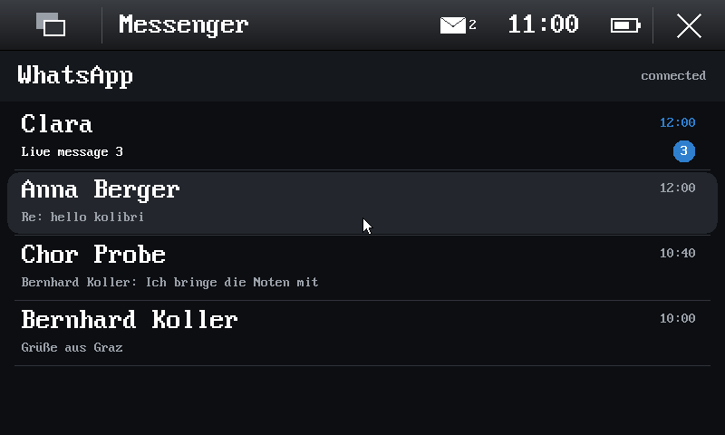
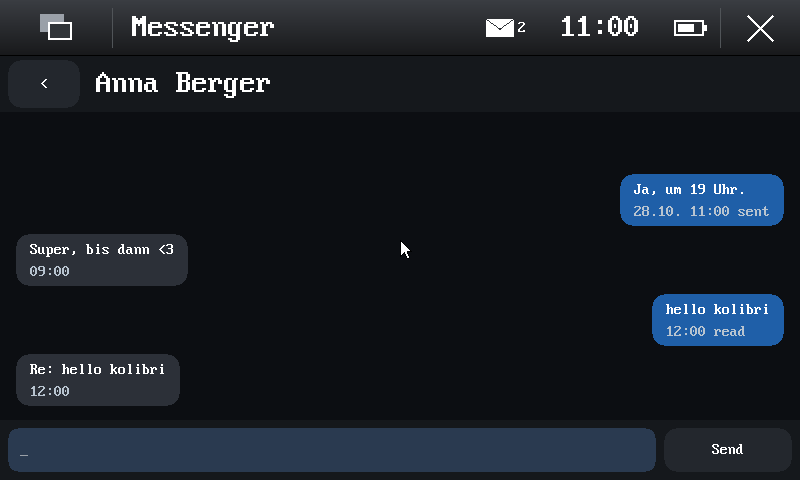

# Messengers: WhatsApp, Telegram and Signal under KolibriOS

The messengers on the Pro1X under KolibriOS use the same backends as on
Maemo Leste where there is one, and an open Signal client library for
Signal:

- **WhatsApp**: Yappari's daemon `yappari-wa`
  ([smatkovi/yappari-leste](https://github.com/smatkovi/yappari-leste)),
  Go with whatsmeow, the multi-device protocol, linked to the main phone by
  QR code or phone number;
- **Telegram**: the libpurple plugin tdlib-purple (Leste's
  `purple-telegram`) on TDLib, in a small libpurple host program;
- **Signal**: [presage](https://github.com/whisperfish/presage), the Rust
  Signal client library of whisperfish and flare, on Signal's own
  libsignal, in a small program of its own (`tools/signal-host`), linked
  to the main phone as a secondary device by QR code.

All three run unchanged as Linux programs on a Linux personality of the kernel;
the user interfaces are KolibriOS programs in the Hildon look. Below: why
that way, the pieces, the protocol between them, the Telegram build, and
what is done. The network under them: [pro1x-network.md](pro1x-network.md).

## Why a Linux personality

- `yappari-wa` is Go. Go's runtime exists for real operating systems
  only; a KolibriOS port of it would be a new `GOOS` (runtime, syscall
  package, net poller), kept up with every Go release. A static
  `linux/arm64` program (`CGO_ENABLED=0`) instead needs some 40 Linux
  system calls (measured below), and whatsmeow, its SQLite (modernc, pure
  Go), TLS and DNS come with it unchanged.
- The Telegram plugin is C++17 on TDLib, libpurple and GLib: threads, a
  C++ runtime, a libc. Statically linked with musl, it too only needs the
  Linux system calls, the same layer.

So one piece in the kernel serves both, and both backends stay what Leste
runs (and what gets their fixes). The KolibriOS programs (ARMv7, AArch32)
stay as they are; Linux programs are AArch64 at EL0 next to them.

## The pieces

```
 KolibriOS (AArch32 programs)            Linux personality (AArch64 EL0)
 +----------------------------+          +-------------------------------+
 | chat (Hildon look):        |  pipes   | yappari-wa -stdio  (WhatsApp)  |
 |  accounts, chats, a chat,  | <------> | purple-host -stdio (Telegram:  |
 |  QR code, login prompts    |          |   libpurple + tdlib-purple)    |
 |                            |          | signal-host -stdio (Signal:    |
 |                            |          |   presage + libsignal)         |
 +----------------------------+          +-------------------------------+
              | function 101                  | Linux system calls
 +-----------------------------------------------------------------------+
 | kernel: tasks, windows | kernel/linux: ELF, memory, threads, futexes, |
 |                        | files, sockets, epoll | kernel/net: lwIP      |
 +-----------------------------------------------------------------------+
```

### The protocol: JSON lines over a pipe

A backend's standard input and output are a pair of kernel pipes; the
UI program starts the backend and reads and writes them through function
101 (below). One JSON object per line, shaped after Yappari's D-Bus
interface, so the D-Bus methods and signals map one to one:

```
UI -> backend   {"id": 7, "call": "SendText", "args": ["", "4366...@s.whatsapp.net", "hello"]}
backend -> UI   {"id": 7, "result": ["3EB0..."]}
                {"id": 8, "error": "not connected"}
backend -> UI   {"signal": "QRCode", "args": ["2@..."]}
                {"signal": "Message", "args": ["id", "chat", "sender", "pushname", 1761750000, false, "text", "hi", "", 0]}
```

- `yappari-wa -stdio`: the same methods and signals as on the session
  bus (the list is in `backend/main.go` of yappari-leste); D-Bus stays the
  default on Leste. The questions it asks the bus (is the UI running,
  desktop notifications) are answered by the pipe: the UI is the other end.
- `purple-host -stdio` and `signal-host -stdio` speak the same shapes
  where the chats need them (below), and a few calls of their own for
  their logins (Telegram's `Login`, `Input`).

#### The calls and signals the messenger uses

Yappari's shapes are the reference (its D-Bus interface, `methods.go` and
`events.go` of yappari-leste: nothing was changed there); the other two
backends were brought to them. Arguments in order; `[...]` an array.

| | arguments / result | WhatsApp (yappari-wa) | Telegram (purple-host) | Signal (signal-host) |
| --- | --- | --- | --- | --- |
| `Status()` | -> state, account | `logged-out`, `connecting`, `connected`, `disconnected`; the own JID | the same states; the phone number | the states; no account |
| `GetQR()` | -> code (and `QRCode` signals) | whatsmeow's pairing codes | - | Signal's provisioning address |
| `Login(phone)`, `InputReply(id, text)`, `InputCancel(id)` | | - | the account, Telegram's questions | - |
| `GetContacts()` | -> [[id, name, push name]...] | the address book (full name, else first or business name), WhatsApp's push names | the buddy list: buddy name, alias, server alias | presage's contacts: ACI, name, "" |
| `GetGroups()` | -> [[id, subject]...] | the joined groups | the buddy list's chats: the `id` component (the conversation's name), the title | presage's groups: `group:` and the master key in hex, the title |
| `SendText(id, chat, text)` | -> id | the id given, else a new one | the id given, else `tg-T-N`; also `SendText(chat, text)` | the message's timestamp (ms, a string); the id given is not used; also `SendText(chat, text)` |
| `MarkRead(chat, sender, [ids])` | | read receipts to WhatsApp | accepted, nothing done: tdlib-purple marks what it shows read itself | accepted, nothing sent yet |
| signal `Message`, `History` | id, chat, sender, push name, time (s), from me, kind, text, mime type, size | live and from the history sync; `kind` text, image, video, audio, voice, document, sticker, location, contact | `Message` only (tdlib-purple's missed messages come as live ones); kind `text` | live, and the store's newest 40 per contact and group at a start (`History`); kind `text` |
| signal `Receipt` | chat, sender, [ids], kind, time | `server` and `error` (sending), `delivered`, `read`, `read-self`, `played`, `played-self` | `server` when tdlib-purple shows the message sent, `error` (an error in the conversation, or not shown in a minute) | `server` after sending; `delivered`, `read` (the other side's receipts) |
| signal `ChatState` | chat, sender, composing | WhatsApp's chat presence | - | a person's typing (not a group's: its message has the group's id, not its key) |
| signal `StateChanged` | state (, text) | | | |
| signal `Error`, `Notice` | text / title, primary, secondary | | | |

The chats are each backend's own addresses: WhatsApp's JIDs
(`4366...@s.whatsapp.net`, groups `...@g.us`); tdlib-purple's
conversation names (`id<user id>` a person, `chat<chat id>` a group,
`secret<id>` a secret chat: `getPurpleBuddyName`, `getPurpleChatName` in
tdlib-purple's `client-utils.cpp` and `purple-info.cpp`); Signal's ACI
(a UUID) or `group:` with the group's master key. The messenger passes
them back as it got them.

A message sent: the messenger shows it at once ("sending..."), calls
`SendText("", chat, text)`, takes the backend's id from the result, and
moves it on with the `Receipt`s (sent, delivered, read; "not sent" for
`error` or an error result). purple-host's sent messages come back from
tdlib-purple once Telegram has them ("tdlib will shortly present it as a
new message", tdlib-purple's `sendMessage`): purple-host gives that
`Message` the id `SendText` returned, so the messenger sees it once.

### Function 101: Linux programs (KolibriOS for ARM)

| ebx | |
| --- | --- |
| 1 | start: ecx = path, edx = arguments (one string, space separated); eax = handle or -1 |
| 2 | write to its standard input: ecx = handle, edx = buffer, esi = length; eax = bytes or -1 |
| 3 | read its standard output: ecx = handle, edx = buffer, esi = size; eax = bytes (0: none now), -1 when it ended |
| 4 | status: eax = 0 running, 1 ended (and ebx its exit code) |
| 5 | stop it |

Output arriving posts event 8 (`EV_NETWORK`, KolibriOS's event for data)
to the program that started it, so the UI waits with function 10 as usual.

### Function 70 on the Linux tree: the messenger's own files

KolibriOS's file system function (70) reads only the ramdisk (`/sys`,
`/rd/1`). On the AArch64 kernel an absolute path outside those reaches
the Linux personality's tree (`kernel/syscall.c` `linux_tree`,
`kernel/linux/file.c` `lx_kfs_*`): its RAM file system is writable there
(`/home/user`, `/tmp`, ...), the ramdisk's Linux files readable.

| subfunction | |
| --- | --- |
| 0 | read a file (as on the ramdisk: eax 0, or 6 at its end; ebx the bytes) |
| 2 | create or rewrite a file (its folder must be there) |
| 3 | write into a file at the offset |
| 5 | information (attributes 0x10 for a folder, the size) |
| 9 | create a folder, and the folders above it that are missing |

Errors: 5 not found, 8 no room, 10 refused (read-only, a folder), 7 a
buffer outside the program. Like the backends' stores, these files live in
RAM: they outlast a program (the messenger started again) but not
KolibriOS.

## The chats in the messenger (`apps/messenger`)

Without a parameter the messenger asks which service (1 WhatsApp, 2
Telegram, 3 Signal; `kolibri.args=whatsapp`, `telegram[,NUMBER]` or
`signal` start one directly). Until the service is linked it shows the
linking (the QR code; Telegram's number and questions); then:

- **the chats**: newest first, each with its name (the contact's or the
  group's from `GetContacts`/`GetGroups`, else the sender's own name from
  its messages, else the address: WhatsApp's number), its last message
  (`You: ...` for one's own, `Name: ...` in a group), its time (today's as
  14:05, older ones as 29.10.), the unread ones as a number. Up/Down
  choose (the chosen one lit), Page Up/Down, Home/End, Enter opens; a tap
  opens one.
- **a chat**: the messages as bubbles, received on the left (in a group
  with the sender's name), sent on the right with how far they got
  (sending..., sent, delivered, read, not sent); the newest at the bottom,
  Up/Down and Page Up/Down scroll (a tap on the upper or lower half too);
  the line at the bottom takes what is typed, Enter or Send sends;
  "typing..." under the name while the other side writes (`ChatState`);
  Escape or `<` goes back. Opening a chat reads its unread messages
  (`MarkRead` for WhatsApp's).
- Messages arrive live: into the open chat, or as an unread one in the
  list. Ctrl+Q (or the shell's close) ends the messenger and its backend.

 

(QEMU, the fake backend as WhatsApp: `tests/messenger/chatcheck.py`'s
screenshots after sending in a chat and going back.)

Kinds other than text show as `[image] caption` and the like (media are
not fetched yet). Times are shown in Central European time (UTC+1, as the
phone program; no time zone setting yet). The keyboard types ASCII
(KolibriOS's keyboard mode); received text is UTF-8, drawn with the
kernel's UTF-8 font (code page 437's glyphs: Latin-1 and a few more, `?`
for the rest). Up to 80 chats with their newest 40 messages each, and
1500 names.

**Kept per service** in `/home/user/.local/share/messenger/SERVICE/chats.json`
(`SERVICE` whatsapp, telegram or signal; function 70 above), written a few
seconds after a change and when the messenger ends, read when it starts,
before the backend answers. JSON lines, read with the same reader
(`lib/json.h`):

```
["messenger",1,"whatsapp"]
["chat","4366411111111@s.whatsapp.net","Anna Berger",2,0,1793330416]      id, name, its source (2 contact, 1 own), unread, time
["msg","3EB0...","4366411111111@s.whatsapp.net","Anna",1793330416,false,0,"Super, bis dann <3"]
                                            id, sender, sender's name, time, sent by me, state (0 received, 1 sending, 2 sent, 3 delivered, 4 read, 5 not sent), text
```

Messages are known by their id: the history a backend sends again is not
shown twice. The file lives in RAM like the backends' own stores
(`session.db`, `~/.purple`, `store.db`): it outlasts the messenger, not
KolibriOS, until KolibriOS can write to the phone's storage.

The Hildon shell for a keyboard alone: Enter at home opens the launcher,
typing a program's name there chooses it (`mes` the messenger), Enter
starts it. There is no on-screen keyboard; the Pro1X has its own.

## The tests

On the PC, `make -C tests/messenger` (with `PURPLE_HOST=`, `SIGNAL_HOST=`,
`YAPPARI_WA=` for the real backends, run by `qemu-aarch64`):

- `json_test`: the JSON reader (Yappari's lines as Go writes them,
  `\u003c`, `\u00fc`, a surrogate pair, nesting, numbers in strings,
  broken lines, too many nodes) and the writer, 20 checks;
- `hosttest.py`: each backend's protocol, no account and no network:
  the fake backend (below) in all three roles; purple-host with its test
  protocol (`PURPLE_HOST_TEST=1`: libpurple's conversations and buddy
  list, a person's and a group's first messages, sending with the message
  back under SendText's id, its Receipt, the reply, markup across, and
  started again on the same `~/.purple` the account logs in by itself);
  purple-host, signal-host and yappari-wa logged out (Status, empty
  lists, SendText refused).

In QEMU, `make test-chats` (`PURPLE_HOST=` adds the real purple-host):
`tests/messenger/fakepeer` (Go, linux/arm64) is a backend from fixtures,
put on the ramdisk as all three programs: linked from the start, two
contacts and one with a push name only, a group, a few messages of
history, a message from the third contact every 10 seconds, SendText
answered with an id, Receipts (server, delivered, read) and a reply.
`tests/messenger/chatcheck.py KERNEL SERVICE` drives the messenger with
QEMU's keyboard (virtio-keyboard-device, which the virt platform now
reads: `kernel/platform/virtio_input.c`) and searches its screenshots for
the texts, drawn from the kernel's own fonts in the messenger's colours:
the names in the list, the unread count, a chat's messages, a message
typed and sent (the backend's console line), its receipts, the reply
live, the third contact's count gone up meanwhile, and after Ctrl+Q and a
start through the shell's launcher the list as it was kept.
`chatcheck.py KERNEL telegram-purple` does it with the real purple-host
and its test protocol (`/etc/purple-host-test` on the ramdisk: the Linux
personality has no environment of one's own), so libpurple runs under
the Linux personality with the chats on top.

The linking QR codes were checked again with the real backends
(`tests/linux/qrcheck.py`, Signal's and WhatsApp's servers, no account
linked).

## The Linux personality (`kernel/linux/`)

What a static Go program does at start and while running, measured with
`qemu-aarch64 -strace` on a Go 1.27 hello world and on `yappari-wa`:

| | calls | here |
| --- | --- | --- |
| memory | `mmap` (anonymous, large `PROT_NONE` reservations: two of 512 MiB, 64 MiB, 8 MiB at start; then `MAP_FIXED` read-write pieces), `munmap`, `mprotect`, `madvise`, `brk` | 4 KiB pages, three-level tables of the process's own, pages allocated on first touch (data abort -> a zeroed page), reservations cost only address space. The address space: the first GiB (the program's ELF, from 0x10000) and 64-256 GiB (mmap) |
| threads | `clone(CLONE_VM \| CLONE_THREAD \| ...)`, `gettid`, `set_tid_address`, `exit`, `exit_group`, `sched_yield`, `sched_getaffinity` (one CPU) | a thread is a kernel task sharing the process's tables; x0-x30, SP_EL0, TPIDR_EL0, the FP/SIMD registers saved per thread |
| waiting | `futex` (WAIT, WAKE, private, with timeouts), `nanosleep`, `clock_gettime` (realtime, monotonic: the generic timer), `epoll_create1`/`epoll_ctl`/`epoll_pwait`, `eventfd2` | the kernel keeps no stack per task: a waiting call is a wait state, re-run or answered when the thread wakes |
| signals | `rt_sigaction`, `rt_sigprocmask`, `sigaltstack` (recorded), `tgkill` (Go's preemption by `SIGURG`: dropped; Go then preempts at function entries) | no delivery yet; a fault ends the process with a register dump |
| files | `openat`, `read`, `write`, `pread64`, `pwrite64`, `close`, `fstat`/`newfstatat`, `lseek`, `fcntl` (locks always granted: one process per file), `getdents64`, `mkdirat`, `unlinkat`, `renameat`, `ftruncate`, `fsync`, `readlinkat`, `getcwd` | the ramdisk read-only under `/`, a RAM file system for `/tmp`, `/var` and `$HOME`; `/dev/null`, `/dev/urandom`; `/etc/resolv.conf` from the DHCP lease; the CA bundle `/etc/ssl/certs/ca-certificates.crt` on the ramdisk |
| network | `socket` (TCP, UDP, v4), `connect` (non-blocking: `EINPROGRESS`), `getsockopt(SO_ERROR)`, `setsockopt`, `getsockname`, `getpeername`, `sendto`, `recvfrom`, `read`, `write`, `shutdown` | sockets on lwIP's raw API, readiness to epoll |
| other | `getrandom`, `uname`, `prlimit64`, `getpid`, `getuid` and friends | the kernel's generator ([rng.md](rng.md)): ChaCha20 with fast key erasure, seeded on the phone from the SoC's PRNG and kexec's seed from Linux, in QEMU from virtio-rng; `getrandom` and `/dev/urandom` wait for the seed; each program's first use said on the console |

Not planned: `fork`/`exec` (neither backend runs programs), shared
memory between processes, `ptrace`.

## WhatsApp: yappari-wa

- Built as on Leste: `CGO_ENABLED=0 GOOS=linux GOARCH=arm64 go build` in
  yappari-leste's `backend/` (21 MiB), put on the ramdisk.
- Its state (`$XDG_DATA_HOME/yappari-wa/session.db`, the linked device's
  keys) is in the RAM file system: **lost at every reboot** until KolibriOS
  can write somewhere. Options: `tools/pro1x-kexec.sh` brings Leste's
  `session.db` along (the same linked device; Leste is gone while
  KolibriOS runs, but the Signal sessions move on under KolibriOS, and
  Leste's copy is stale afterwards); or a native UFS driver (large).
- Its clock must be right (TLS): KolibriOS's real-time clock, which the
  modem sets on the phone.

## Telegram: the purple host

`purple-host` (`tools/purple-host/`) is a C program of its own, linked
statically with musl: libpurple's core (no UI), tdlib-purple as a static
protocol (`purple_init_telegram_tdlib_plugin()`), GLib's main loop, the
JSON lines of `yappari-wa -stdio` on stdin/stdout. Methods `Status`,
`Login(phone)` (tdlib-purple's account name is the phone number),
`InputReply(id, text)`, `InputCancel(id)`, `Logout`, and the chats' calls
of the table above (`SendText`, `GetContacts`, `GetGroups`, `MarkRead`);
signals `StateChanged`, `Input` (what the plugin asks: the login code, the
password), `Notice`, `Message`, `Receipt`, `Error`.

- Texts: libpurple's conversations carry markup; incoming text is
  stripped and unescaped (`purple_markup_strip_html`,
  `purple_unescape_html`), outgoing escaped (`g_markup_escape_text`), as
  tdlib-purple strips and unescapes what it sends (`transmitMessage`).
- A group's conversation must be open to write to it (tdlib-purple opens
  it when a message comes in); otherwise `SendText` asks libpurple to join
  it and answers "the group is being opened: send again".
- The protocols are registered before libpurple loads `accounts.xml`
  (from the core's `debug_ui_init` hook; libpurple's accounts of an
  unknown protocol get no statuses and never connect), and
  `purple_accounts_restore_current_statuses()` connects the enabled ones,
  as Pidgin does at its start: a purple-host started again (the messenger
  started again) is logged in by itself, from TDLib's database in
  `~/.purple`.
- A test protocol (`prpl-kolibri-test`, with `PURPLE_HOST_TEST=1` or a
  file `/etc/purple-host-test`) stands in for Telegram in the tests: any
  account name logs in, two people and a group in the buddy list, a
  message from each at the start, what is sent comes back as
  tdlib-purple brings it back, with a reply.

The protocol is [UnitedMarsupials' tdlib-purple](https://github.com/UnitedMarsupials/tdlib-purple)
0.9.4 (2026-10-27), the maintained fork of ars3niy's tdlib-purple (which
stopped at TDLib 1.7.9: Telegram refuses that one now with
`UPDATE_APP_TO_LOGIN`, tried). Its licence: GPL 2 or later, as upstream
(the `LICENSE` file; GitHub shows NOASSERTION only because it does not
recognise the file). TDLib is 1.8.67 (commit `bc9c263e2`); the fork
detects the version and probes the API.

`tools/purple-host/build.sh WORKDIR` builds all of it with `zig cc -target
aarch64-linux-musl` (Arch's `zig`), the sources pinned by SHA-256 and
commit: zlib 1.3.1, OpenSSL 3.0.15 (the CPU's features from `AT_HWCAP` with
musl too: else it probes with instructions and SIGILL, which the Linux
personality does not deliver), GLib 2.80.5 (meson, static), libxml2
2.12.9, libpurple 2.14.14 (no UI, no protocols of its own, no D-Bus, no
NLS), fmt 11.0.2, TDLib (its code generators natively first; its `tdjson`
static, which zig's linker needs), tdlib-purple without calls, animated
stickers and translations. TDLib takes some 1.5 h on 2 cores; the work
directory some 5 GB. The result: one static program of 35 MB.

`make run-telegram PURPLE_HOST=WORKDIR/build/host/purple-host
TG_NUMBER=+...`: QEMU with the messenger in Telegram mode (`kolibri.args=
telegram,NUMBER`), logging in with that number at once.

TDLib's database (the login) is in the RAM file system, the same
persistence question as WhatsApp's.

## Signal: the signal host

`signal-host` (`tools/signal-host/`) is a Rust program of its own on
[presage](https://github.com/whisperfish/presage) (the library under
flare and whisperfish), which is built on whisperfish's
[libsignal-service-rs](https://github.com/whisperfish/libsignal-service-rs)
(Signal's service: the REST calls, the websockets, the provisioning) and
Signal's own [libsignal](https://github.com/signalapp/libsignal) (the
protocol, zkgroup, the account keys). It links as a **secondary device**
(as Signal Desktop does): GetQR opens Signal's provisioning websocket,
the server hands out a provisioning address, and the program shows it as
a QR code; the phone's Signal (Settings, Linked devices, Link new device)
scans it and sends the account's keys over that socket. The store is
presage's SQLite one (`$XDG_DATA_HOME/signal-host/store.db`, in the RAM
file system: lost at a reboot, as WhatsApp's).

The protocol is `yappari-wa -stdio`'s (the table above), so the
messenger's WhatsApp path serves it (`kolibri.args=signal`: the title,
the linking text, `/bin/signal-host`):

```
UI -> host   {"id": 1, "call": "Status", "args": []}
host -> UI   {"id": 1, "result": ["logged-out"]}               (or "connecting", "connected")
UI -> host   {"id": 2, "call": "GetQR", "args": []}
host -> UI   {"signal": "QRCode", "args": ["sgnl://linkdevice?uuid=...&pub_key=..."]}
             {"id": 2, "result": ["sgnl://linkdevice?uuid=...&pub_key=..."]}
UI -> host   {"id": 3, "call": "SendText", "args": ["", "<ACI uuid> or group:<master key, hex>", "hello"]}
host -> UI   {"id": 3, "result": ["1761750000000"]}
             {"signal": "Receipt", "args": ["<chat>", "", ["1761750000000"], "server", 1761750000]}
UI -> host   {"id": 4, "call": "GetContacts", "args": []}
host -> UI   {"id": 4, "result": [[["<ACI uuid>", "<name>", ""]]]}
             {"signal": "StateChanged", "args": ["connected"]}
             {"signal": "Message", "args": ["<timestamp ms>", "<chat>", "<sender>", "", 1761750000, false, "text", "hi", "", 0]}
             {"signal": "History", "args": [... the store's, at a start]}
             {"signal": "Receipt", "args": ["<chat>", "<sender>", ["<timestamp ms>"], "read", 1761750000]}
             {"signal": "ChatState", "args": ["<chat>", "<sender>", true]}
             {"signal": "Error", "args": ["..."]}
```

The server closes an unscanned provisioning socket after about 90 s
(websocket close 1000, "Timeout"; seen in a 7-minute run on the PC: a new
address every 91 s); linking starts again and a new QRCode signal
follows (an Error signal only when no address came at all). After linking (and at a start with
a linked store) the host receives: StateChanged `connecting`, then
`connected` once the server's queue is empty; text messages (their own,
sent from the phone, too: `fromMe` true) as Message signals; SendText to a
contact (its ACI) or a group (its master key). Received messages, the
contacts and the groups are in presage's store as well. Only linking up
to the QR code has been tried (below); receiving and sending have not run
against Signal yet, since no account is linked in tests.

**Versions** (`tools/signal-host/Cargo.toml`, all of them in its
`Cargo.lock`, built with `--locked`):

| | |
| --- | --- |
| presage, presage-store-sqlite | `aeaedf99b` (2026-10-27, "feat(manager): sync groups from the storage service") |
| libsignal-service-rs | `72a09876` (2026-10-25, presage's pin), without `cdsi` (no libsignal-net, no BoringSSL) |
| libsignal (libsignal-protocol, -core, -account-keys, signal-crypto, zkgroup, usernames) | tag `v0.99.0` (`439f035d9`) |
| SQLite | libsqlite3-sys 0.36.0 (whisperfish's rusqlite fork `2a42b335`, as presage pins it), plain SQLite compiled in (`bundled`: not presage's default SQLCipher) |
| TLS | rustls 0.23.45 with ring 0.17.14 (libsignal-service installs it as the provider; Signal's servers are checked against the certificates libsignal-service carries, `certs/`), and AWS-LC (aws-lc-sys 0.46.0) through reqwest's `rustls` feature (presage's link previews; it is linked, not used for Signal's servers) |
| Rust | 1.99.1 (Arch's `rust`, `rust-aarch64-musl`: Rust's own musl, self-contained) |

**Licences:** presage, presage-store-sqlite, libsignal-service-rs and
libsignal are AGPL-3.0-only (their `LICENSE` files and `Cargo.toml`), so
`signal-host` is AGPL-3.0-only too (its `Cargo.toml`); whoever runs it
for others must offer its source. It is a program of its own, started
through function 101, not linked with KolibriOS (GPL 2). The rest: ring
Apache-2.0 AND ISC, AWS-LC ISC/Apache-2.0 (with MIT and BSD parts),
rustls Apache-2.0/MIT/ISC, SQLite public domain, tokio and the other
crates MIT/Apache-2.0.

**The build:** `tools/signal-host/build.sh WORKDIR`: `cargo build
--release --locked --target aarch64-unknown-linux-musl`, the C parts
(SQLite, AWS-LC, ring's assembly) through `zig cc -target
aarch64-linux-musl` (wrappers that drop the cc crate's `--target` and
zig's sanitizer for code built without -O: AWS-LC's jitterentropy), the
link by clang with lld against Rust's self-contained musl
(`+crt-static`). The target directory some 1.2 GB; the result one
static program of 17 MB.

`make run-signal SIGNAL_HOST=WORKDIR/signal-host`: QEMU with the
messenger in Signal mode (`kolibri.args=signal`). No CA bundle is needed:
the host trusts only the certificates it carries for Signal.

**What it needed of the Linux personality** (measured with
`qemu-aarch64 -strace` on the PC, then in QEMU): 47 system calls, all
there before but `pwritev2`; and one answered wrongly:

- `pwritev2` (287): musl 1.2.5's `pwrite` tries it first with
  `RWF_NOAPPEND` (POSIX's pwrite on an `O_APPEND` file), and falls back to
  `pwrite64` on `ENOSYS`; SQLite writes with `pwrite`, so every write
  logged "system call 287 not there". Now `preadv`, `pwritev`, `preadv2`
  and `pwritev2` are there (`kernel/linux/file.c`, offset -1: the file's
  position; `RWF_APPEND`, `RWF_NOAPPEND`).
- `mkdirat` of a directory whose parent is missing answered `EROFS`
  instead of `ENOENT`, so Rust's `create_dir_all` gave up at once
  (`~/.local/share/signal-host`); `EROFS` is now only for a parent on the
  ramdisk (`/bin/...`), as for `openat` with `O_CREAT`.

SQLite's WAL index (`store.db-shm`) is a `MAP_SHARED` mapping, which the
personality gives as a private copy. That is enough here: SQLite maps the
index once per process and shares it between its connections (one
`mmap` in the trace for presage's three), and no other process uses the
file. A real shared mapping (the RAM file's pages themselves) would be
needed for two processes on one database.

The rest was there: threads (`clone`, futexes), `epoll` and `eventfd`
(tokio), TCP with keep-alive options, UDP and `bind` (musl's resolver),
`ppoll`, `sendmsg`/`recvmsg`, file locks (`F_SETLK`), `fsync`,
`ftruncate`, `getrandom`.

## Status

- [x] the design (this document, [pro1x-network.md](pro1x-network.md))
- [x] the network stack in QEMU (virtio-net, lwIP, DHCP, DNS: [pro1x-network.md](pro1x-network.md))
- [x] the Linux personality (`kernel/linux/`): `tests/linux/hello` (Go: goroutines, timers,
  the GC), `tests/linux/nettest` (files, Go's resolver, three HTTPS requests at once, TLS 1.3)
- [x] `yappari-wa -stdio` in yappari-leste (`backend/stdio.go`)
- [x] function 101 and `messenger`, its first part: the daemon started, its state, linking by
  QR code (`lib/qr.h`, checked with zbarimg against the daemon's code)
- [x] the chats in `messenger` for all three services: the conversation list (names, last
  message, time, unread count), a conversation (bubbles with time and state, scrolling,
  sending, messages live), kept per service in the RAM file system (function 70 on the Linux
  tree); one protocol for the three backends (the table above); in QEMU against a fake backend
  and against purple-host with its test protocol (`make test-chats`, the screenshots
  checked), the backends on the PC (`make -C tests/messenger`). Not with a real account yet
- [ ] media (pictures, voice messages), starting a new chat with a contact, an on-screen
  keyboard
- [x] the purple host's build and program (`tools/purple-host/`); in QEMU (`make run-telegram`)
  the messenger's Telegram mode logs in with a number that is not anyone's, and Telegram's
  question for the login code shows in its window (sendmsg/recvmsg were missing before)
- [x] the signal host (`tools/signal-host/`, presage): on the PC under `qemu-aarch64` and in
  QEMU (`make run-signal`), the messenger's Signal mode shows the linking QR code from Signal's
  server (below)
- [x] randomness ([rng.md](rng.md)): the SoC's PRNG and kexec's seed on the phone, waiting for
  the seed; in QEMU all three backends take their random bytes from it (`make -C tests/rng
  qemu` with the backends); on the phone the check of 2026-10-31 (`kolibri.rngtest`)
- [ ] the phone: Wi-Fi ([pro1x-network.md](pro1x-network.md)), persistence

In QEMU (`make run-messenger YAPPARI_WA=<yappari-wa for linux/arm64>`): `messenger` starts the
daemon, which connects to WhatsApp through lwIP and Go's TLS and hands over its QR codes (a new
one every 20 seconds); a screenshot of QEMU's screen decodes with `zbarimg` to the daemon's code
of that moment. Linking itself was not tried (no account is used in tests). On the Pro1X it
may be, as far as the random numbers go, once its console shows `rng: seeded from the SoC's
PRNG (...), the boot loader's seed (...)` ([rng.md](rng.md), "On the devices"); never while
it says `rng: WEAK`.

Signal, the same way (`tests/linux/qrcheck.py`, which waits for the backend's code on the
serial console, takes QEMU's screenshot and decodes it with `zbarimg`):

```
make PLATFORM=arm64 LINUX_FILES="bin/signal-host=WORKDIR/signal-host" all
python3 tests/linux/qrcheck.py build/arm64/kernel.bin 200 sgnl://linkdevice -- \
    -append "kolibri.run=/sys/messenger kolibri.args=signal"
qrcheck: the backend's code: sgnl://linkdevice?uuid=X7dj6ZeuXXyfNNkinUIKmw%3D%3D&pub_key=Bdwl...
qrcheck: on the screen:       sgnl://linkdevice?uuid=X7dj6ZeuXXyfNNkinUIKmw%3D%3D&pub_key=Bdwl...
qrcheck: the same
```

The address is a real one from Signal's server (`chat.signal.org`'s provisioning socket needs
no account). It was not scanned: linking a real account waits for the phone's check of its
random numbers ([rng.md](rng.md)) and the user.
